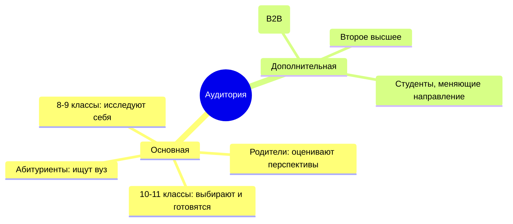
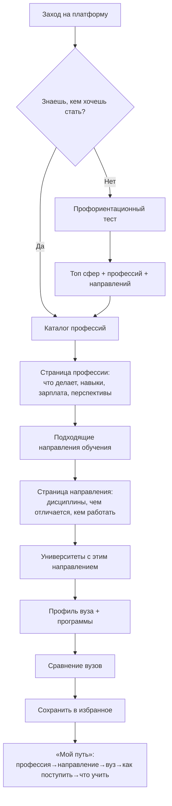
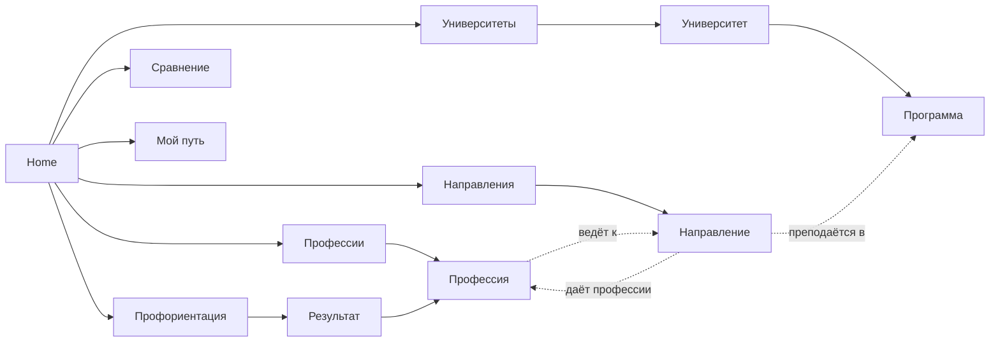
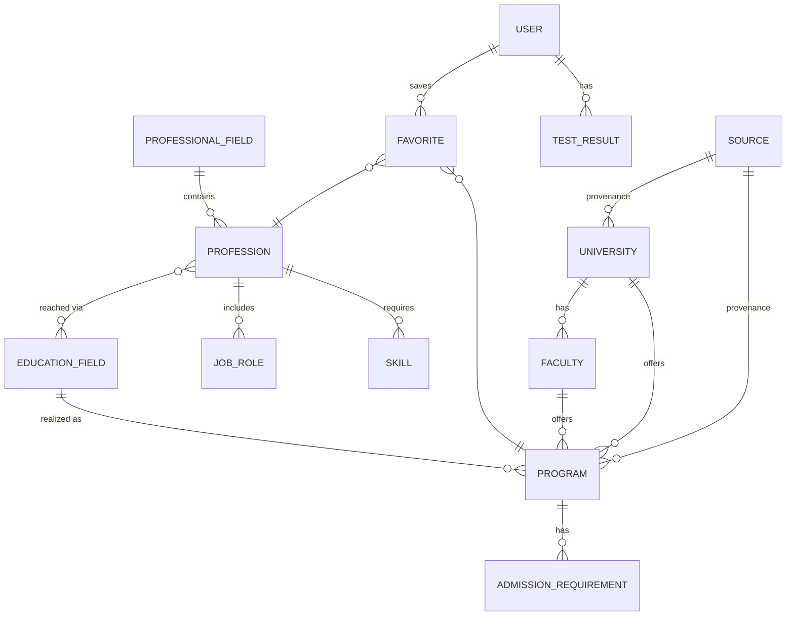

# Rohnamo — Product Blueprint

> **Rohnamo** (тадж. *роҳнамо* — «проводник, путеводитель»)
> Career & Education Discovery Platform для школьников и абитуриентов Центральной Азии.
> Слоган: **«От „не знаю“ — до „поступаю“».**

Этот документ — целостная продуктовая концепция для передачи команде разработки. Он покрывает шаги STEP 1 → STEP 16 из брифа.

---

## 1. Product Vision

> Каждый выпускник региона должен иметь возможность сделать осознанный выбор будущего — понимая, кем он может стать, что для этого изучать и где получить образование, — независимо от связей, города и достатка семьи.

## 2. Product Mission

Провести пользователя за один связный маршрут от вопроса «кем мне стать?» до конкретного плана «какую профессию выбрать → какое направление изучать → в какой университет поступать → что делать уже сейчас», опираясь на понятные, проверяемые данные.

## 3. Problem Statement

**Core Problem.** Школьники выбирают профессию и вуз вслепую: информация разрознена, на языке бюрократии, не связана между собой, и не отвечает на главный вопрос — *«как моё «нравится» превращается в профессию, образование и университет?»*

**User Problems (по частоте):**
| # | Проблема | Кого касается |
|---|----------|---------------|
| 1 | Не понимаю, кем хочу стать | 8–11 классы |
| 2 | Не вижу разницы между похожими профессиями/направлениями | 10–11, абитуриенты |
| 3 | Не понимаю, чем факультет ≠ направление ≠ программа | все |
| 4 | Не знаю, что изучать и какие предметы важны | 8–11 |
| 5 | Не знаю, где есть нужное направление и чем вузы отличаются | абитуриенты, родители |
| 6 | Не понимаю перспективы: спрос, зарплата, удалёнка | все + родители |
| 7 | Данные устаревшие/недостоверные | все |

**Почему Google недостаточно** (ответ на прямой вопрос брифа): Google выдаёт *список статей*, а не *связанный граф решений*. Он не знает пользователя, не связывает «профессия → направление → конкретный вуз в моём городе → как поступить», не сравнивает варианты по единым критериям, не отделяет проверенные данные от слухов и не даёт персональный план. Rohnamo — это не поиск, а **навигатор по решению**.

## 4. Value Proposition

| Для кого | Ценность |
|---|---|
| Школьник 8–9 | «Я понял свои сильные стороны и увидел 3–5 сфер, которые мне подходят» |
| Школьник 10–11 | «Я связал профессию с направлением и списком университетов» |
| Абитуриент | «Я сравнил вузы по единым критериям и знаю, как поступить» |
| Родитель | «Я вижу перспективы и стоимость без маркетингового шума» |
| Университет | «Абитуриенты приходят подготовленными и осознанными» |

Формула: **Самопознание + Связанный граф знаний + Проверяемые данные + Персональный план** — то, чего нет ни у поиска, ни у отдельного вуза.

---

## 5. Target Audience & Segments

### User Personas

**1. Фарход, 15 лет, 9 класс (Душанбе).** «Все говорят про IT, но я не знаю, моё ли это». *Боль:* нет самопонимания. *JTBD:* понять сильные стороны и сузить выбор. *Поведение:* мобильный, TikTok, короткое внимание. *Успех:* прошёл тест, сохранил 3 сферы.

**2. Нигина, 17 лет, 11 класс (Худжанд).** Между медициной и экономикой. *Боль:* не видит разницы направлений и последствий выбора. *JTBD:* сравнить профессии/направления и понять путь поступления. *Успех:* собрала «Мой путь» с 2 вузами.

**3. Далер, 18 лет, абитуриент.** Хочет в IT, не знает, где сильнее программа и дешевле. *JTBD:* сравнить вузы по цене, языку, экзаменам. *Успех:* шорт-лист из 3 программ.

**4. Гулнора, 43 года, мама Нигины.** *Боль:* боится «неперспективного» выбора и лишних трат. *JTBD:* оценить спрос/зарплату/стоимость, участвовать в решении. *Успех:* сравнение вузов, которое можно обсудить с дочерью.

**5. Университет (B2B).** *JTBD:* привлекать осознанных абитуриентов, держать данные о программах актуальными. *Успех:* верифицированный профиль, переходы на сайт.

### JTBD (формулировки)
- Когда я *не знаю, кем стать*, я хочу *понять свои склонности*, чтобы *сузить выбор без стресса*.
- Когда я *выбрал профессию*, я хочу *увидеть, какое образование к ней ведёт*, чтобы *не ошибиться с направлением*.
- Когда я *выбрал направление*, я хочу *сравнить университеты по единым критериям*, чтобы *подать документы уверенно*.
- Когда я *сомневаюсь*, я хочу *сравнить варианты бок о бок*, чтобы *принять решение осознанно*.

---

## 6. Core User Journey

**Критический принцип UX:** пользователь не «ищет университет», а *постепенно отвечает на вопрос «кем я хочу стать?»*. Университет — это финал маршрута, а не вход.

---

## 7. Information Architecture

Главное меню: **Профессии · Направления · Университеты · Профориентация · Сравнение · Мой путь** + глобальный поиск.

---

## 8. Core Entities & их различия

Ключевая путаница пользователей — в терминах. Модель это разводит явно:

| Сущность | Что это | Пример |
|---|---|---|
| **ProfessionalField** | Широкая сфера деятельности | IT |
| **Profession** | Профессия внутри сферы | Software Engineer |
| **JobRole** | Конкретная должность/роль | Backend Developer |
| **EducationField** | Направление подготовки (что учат) | Computer Science |
| **Faculty / Department** | Организационная единица вуза | Факультет ИТ |
| **EducationalProgram** | Конкретная реализация направления в вузе | «CS» в ТНУ, 4 года, тадж/рус |
| **University** | Учебное заведение | ТНУ |

**Правило:** `Profession` связана с *несколькими* `EducationField` (многие-ко-многим); `EducationField` реализуется как `EducationalProgram` в конкретном `University` через `Faculty`. Именно эта связь — ядро продукта.

Полный список сущностей: см. `lib/types.ts`. Из исходного списка брифа объединены/уточнены: `Student` → роль внутри `User`; `HardSkill/SoftSkill` → `Skill.type`; `Degree` → атрибут `EducationField/Program`; `Salary/LaborMarket` → поля `Profession` с provenance.

---

## 9. Feature Map & Priority (MoSCoW)

| Фича | Приоритет | Обоснование |
|---|---|---|
| Каталог профессий + страница профессии | **Must** | Core value |
| Каталог направлений + страница направления | **Must** | Core value |
| Связь профессия ↔ направление ↔ вуз | **Must** | Уникальность продукта |
| Каталог/профиль университетов + программы | **Must** | Финал маршрута |
| Профориентационный тест (explainable) | **Must** | Точка входа для «не знаю» |
| «Мой путь» (персональный план) | **Must** | Замыкает ценность |
| Data-provenance (источник/дата/verified) | **Must** | Доверие = выживание продукта |
| Сравнение профессий | **Should** | Снимает выбор-паралич |
| Сравнение университетов | **Should** | Ключ для абитуриентов/родителей |
| Глобальный поиск | **Should** | SEO + навигация |
| Избранное / аккаунт | **Should** | Retention |
| Сравнение направлений («Difference between X и Y») | **Could** | Отличный SEO-контент |
| AI Career Advisor (чат) | **Could → Phase 4** | Ценно, но не для MVP |
| B2B-кабинет вуза | **Won't (MVP)** | После product-market fit |
| Мультиязычность tg/en полностью | **Won't (MVP)** | RU-first, i18n-каркас заложить |

**Core value (без чего продукта нет):** связанный граф *профессия → направление → университет* + доверенные данные. Тест и «Мой путь» усиливают, но граф — фундамент.

---

## 10. MVP Scope

**MVP = «связанный справочник + тест + план», RU, Таджикистан, web (mobile-first).**

Входит: каталоги (профессии, направления, вузы), детальные страницы со всеми связями, explainable-тест, сравнение профессий, «Мой путь» (без авторизации — localStorage), provenance-бейджи, SEO-страницы, админ-загрузка данных через контент-файлы/простую CMS.

Не входит в MVP: AI-чат, полноценный B2B-кабинет, оплаты, полная локализация tg/en, рекомендательный ML.

> ⚠️ **Замечание по концепции пользователя:** список сущностей и фич в брифе избыточен для MVP. Рекомендую резать глубину данных, а не связи: лучше 40 профессий с полными связями, чем 400 несвязанных карточек. Ценность — в графе, не в объёме.

---

## 11. Product Roadmap

| Фаза | Цель | Ключевая функциональность | Метрики | Риски |
|---|---|---|---|---|
| **0 · Research** | Понять рынок ЦА/Таджикистана | Интервью со школьниками/родителями/вузами; сбор данных о 3–5 вузах | Кол-во интервью, качество данных | Мало открытых данных о вузах |
| **1 · MVP** | Доказать core value | Граф + тест + «Мой путь», RU | Activation, Career/University Discovery Rate | Достоверность данных |
| **2 · PMF** | Retention и доверие | Аккаунты, избранное, сравнение вузов, verified-данные, tg-локализация | Retention W4, NPS, доля verified-данных | Удержание, доверие |
| **3 · Growth** | Масштаб контента и трафика | SEO-контент, «Difference between», партнёрства вузов, больше регионов | Органический трафик, охват вузов | Качество при масштабе |
| **4 · AI Personalization** | Персональный советник | AI Career Advisor, персональные roadmap, AI-объяснения | Вовлечённость в AI, конверсия в план | Галлюцинации, стоимость |

## 12. Product Metrics

**North Star Metric:** *количество пользователей, собравших осмысленный «Мой путь» (профессия + направление + ≥1 университет) за период.* Это фиксирует полное прохождение ценности, а не просто визиты.

| AARRR | Метрика |
|---|---|
| Acquisition | Органический трафик, переходы из школ/соцсетей |
| Activation | Начал тест ИЛИ открыл ≥1 профессию (Career Discovery Rate) |
| Retention | Возврат W1/W4; повторное открытие «Мой путь» |
| Revenue (later) | Verified-профили вузов, партнёрства |
| Referral | Шеринг «Мой путь»/сравнения |

Продуктовые KPI: Career Discovery Rate, University Discovery Rate, Test Completion Rate, доля данных со статусом `verified`, среднее число сравнений на сессию.

---

## 13. UX/UI Concept

- **Тон:** современный, дружелюбный, «не как официальный сайт вуза». Ближе к продуктовым EdTech-приложениям, чем к госпорталу.
- **Стиль:** светлый фон, крупная типографика, скруглённые карточки (2xl), один акцентный синий (`brand`), много воздуха.
- **Паттерны:** карточки профессий/направлений/вузов; progress-bar в тесте; «уровневые» полоски (математика/программирование 0–4); provenance-бейджи (зелёный «проверено» / янтарный «требует проверки»); сравнение как таблица со свободным выбором колонок.
- **Онбординг:** развилка на первом экране — «Знаешь, кем стать?» → тест или каталог.
- **Mobile-first**, т.к. основная аудитория — школьники с телефонов.

## 14. Page Structure (маршруты)

| Маршрут | Цель | Ключевые блоки |
|---|---|---|
| `/` | Захватить и направить | Hero + развилка, «как работает», популярные профессии, вузы, CTA сравнения |
| `/careers` | Каталог профессий | Фильтр по сферам, карточки |
| `/careers/[slug]` | Всё о профессии | День, навыки, предметы, карьера, профиль, **→ направления → вузы**, альтернативы |
| `/fields` | Каталог направлений | Карточки |
| `/fields/[slug]` | Всё о направлении | Дисциплины, характеристики, **кем работать**, чем отличается от похожих, где учат |
| `/universities` | Каталог вузов | Карточки + предупреждение о данных |
| `/universities/[slug]` | Профиль вуза | Описание, provenance, таблица программ, «проверьте на офиц. сайте» |
| `/career-test` | Тест | Пошаговые вопросы, прогресс |
| `/career-test/result` | Результат | Профиль, топ-сферы, рекомендации + **«почему»** |
| `/compare/careers` | Сравнение профессий | Таблица с выбором колонок |
| `/compare/universities` | Сравнение вузов | *(Phase 2)* |
| `/my-path` | Персональный план | Профессия→направление→вуз→как поступить→что учить |
| `/favorites` | Сохранённое | *(Phase 2)* |
| `/search` | Глобальный поиск | *(Should)* |

## 15–16. Data Model & ERD

Основные таблицы (production, PostgreSQL): `users, professional_fields, professions, education_fields, universities, faculties, programs, skills, profession_skills, profession_education_field (join), subjects, career_paths, admission_requirements, sources, favorites, test_questions, test_results`. Провенанс (`source_id`, `updated_at`, `verified`) — на всех сущностях с изменчивыми данными.

Реализация в прототипе: типобезопасная модель в `lib/types.ts`, seed-данные в `lib/data.ts` — та же структура, готовая к переносу в БД.

---

## 17. Technical Architecture

| Слой | Выбор | Почему | Для MVP? |
|---|---|---|---|
| Frontend | **Next.js (App Router) + React + TS + Tailwind** | SSR/SSG для SEO, единый стек, быстрая разработка | ✅ |
| Хостинг | Vercel | Нативно для Next.js, edge, дёшево на старте | ✅ |
| Backend | Next.js Route Handlers → выделить в NestJS при росте | Не плодить сервисы раньше времени | ✅ |
| БД | **PostgreSQL** (+ Prisma) | Реляционные связи графа — сильная сторона PG | ✅ (в MVP можно seed-файлы) |
| Поиск | Postgres FTS в MVP → Meilisearch/Typesense позже | Не тянуть Elastic на старте | ✅ / позже |
| CMS | Директория контента + простая админка на том же стеке; альтернативно Payload/Strapi | Контроль над схемой и provenance | ✅ |
| Auth | Auth.js (NextAuth) / Clerk | Быстрый вход, соцсети | Should |
| AI | LLM через API-шлюз + RAG по своей БД, строгий system-prompt, «проверьте на офиц. сайте» | Только на данных платформы, без свободных фактов | Phase 4 |
| Analytics | PostHog (события + воронки) | Продуктовая аналитика из коробки | ✅ |

## 18. Recommendation Engine

**MVP (без ML, объяснимый):**
1. Тест → нормализованные баллы по 8 измерениям (0–100).
2. Каждая профессия имеет `testAffinity` (веса по измерениям) → скор = взвешенное скалярное произведение.
3. Профессии → свёртка в сферы; из топ-профессий → рекомендованные направления.
4. **«Почему рекомендуем»** генерируется из сильнейших измерений пользователя, на которые опирается профессия. → всегда прозрачно, никогда не «диагноз».

Реализация: `lib/test.ts`.

**Продвинутая (Phase 4):** гибрид — контентная фильтрация (эмбеддинги профессий/направлений) + коллаборативные сигналы (что выбирали похожие пользователи) + LLM-объяснения поверх, всё с обязательным «это ориентир».

## 19. AI Strategy

| AI-фича | Фаза | Заметка |
|---|---|---|
| AI Career Advisor (диалог, уточняющие вопросы) | Phase 4 | RAG строго по своей БД |
| AI-объяснение сложных направлений | Phase 3–4 | Кэшируемый контент |
| AI-сравнение профессий/вузов | Phase 4 | Поверх структурированных данных |
| Персональный learning roadmap | Phase 4 | На основе профессии + уровня |

**Правило безопасности:** AI не выдумывает цифры (баллы, цены). Числа — только из БД с provenance; иначе — «проверьте на официальном сайте».

## 20. Admin Panel & 21. Data Management

Workflow контента: **Draft → Review → Published → Archived**. Каждая запись: владелец, `updated_at`, `source`, статус `verified`. Валидация схемы, версионирование, модерация. Критичные данные вузов (цена, проходной балл, места) всегда с меткой актуальности и ссылкой «проверьте на офиц. сайте». Стратегия достоверности — приоритет №1: недостоверность убивает доверие и продукт.

## 22. SEO Strategy

- **URL:** человекочитаемые слаги (`/careers/data-scientist`, `/fields/computer-science`).
- **Контент под интент:** «Кем работать после Computer Science?», «Чем отличается CS от Software Engineering?», «Как стать Data Scientist?», «Лучшие вузы для программистов в Таджикистане».
- **Structured data:** `Occupation`, `Course`, `CollegeOrUniversity`, `FAQPage` (JSON-LD).
- **Internal linking:** плотная перелинковка граф-связей (профессия↔направление↔вуз) — сама архитектура продукта = SEO-сеть.
- **SSG** страниц сущностей для скорости и индексации.

## 23. Analytics

События: `test_started/completed`, `profession_viewed`, `field_viewed`, `university_viewed`, `comparison_used`, `path_created`, `outbound_to_university`. Воронки: Discovery → Compare → Path. Инструмент: PostHog.

## 24. Business Model (этичная монетизация)

| Модель | Как | Этика |
|---|---|---|
| **Verified-профили вузов (B2B)** | Вуз платит за расширенный профиль и актуализацию данных | Не влияет на ранжирование/рекомендации; помечено «партнёр» |
| **Лидогенерация/переходы** | Оплата за квалифицированные переходы на вуз | Прозрачно, без продажи персональных данных |
| **Premium-гайд (B2C, later)** | Углублённый персональный отчёт, консультация | Базовая ценность остаётся бесплатной |
| **Гранты/партнёрства** | EdTech-фонды, программы развития | — |

**Красная линия:** рекомендации никогда не продаются. Спонсорство визуально отделено. Иначе теряется доверие — главный актив.

## 25. Competitive Analysis

> Требуется отдельный research для актуальных данных. Ниже — концептуальные ориентиры.

| Продукт | Сильное | Слабое | Что берём |
|---|---|---|---|
| CareerExplorer | Глубокий тест | Платно, США-центрично, нет вузов ЦА | Explainable-результаты |
| My Next Move / O*NET | Огромная база профессий (США) | Сухо, нет связи с вузами региона | Структура данных о профессиях |
| UCAS | Отличный подбор вузов (UK) | Только UK, нет профориентации | UX сравнения программ |
| Coursera Career Academy | Связь навык→курс | Курсы, не университеты | Идея skill→education |

**Наш дифференциатор:** единственный, кто связывает *профориентацию → профессию → направление → конкретный вуз Центральной Азии* с проверяемыми данными и на локальных языках.

## 26–27. Risks & Success Metrics

| Риск | Митигиция |
|---|---|
| Неправильные рекомендации | Explainable-скоринг, формулировки «может подойти», не «диагноз» |
| Устаревшие данные | Provenance, `updated_at`, verified-статус, «проверьте на офиц. сайте» |
| Сложность сбора данных о вузах | Начать с 3–5 вузов вглубь; B2B-актуализация; краудсорсинг с модерацией |
| Низкая retention | «Мой путь», избранное, возвращающие сценарии, email/push (later) |
| Сложный онбординг | Одна развилка на входе, тест ≤ 8 вопросов |
| Недоверие | Прозрачные источники, отделённое спонсорство |
| AI-галлюцинации | RAG по своей БД, запрет на выдуманные числа |

Success (12 мес): NSM (собранные «Мой путь»), Test Completion > 60%, доля verified-данных вузов, органический трафик по SEO-запросам, retention W4.

---

## Замечания к исходной концепции (честно)

1. **Сущностей слишком много для MVP** — объединил (см. §8). Гнаться за полнотой модели вредно на старте.
2. **Главная ценность = связь, а не объём.** Рекомендую узкий, но полностью связанный набор данных (напр., IT глубоко + 3–4 другие сферы), чем широкий несвязанный каталог.
3. **AI-чат — не для MVP.** Риск галлюцинаций на чувствительной теме (будущее ребёнка) выше пользы, пока нет верифицированной базы. Сначала — доверенные данные, потом AI поверх них.
4. **Достоверность данных — не «фича №20», а фундамент.** Поднял в Must-have и в центр модели (provenance на всех изменчивых полях).
